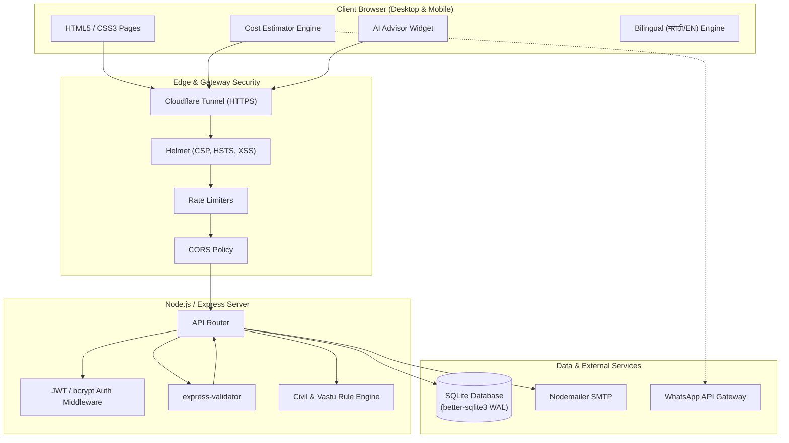

# 🏗️ Suyog Constructions — Enterprise Web Platform

[](https://nodejs.org/)
[](https://expressjs.com/)
[](https://sqlite.org/)
[]()
[]()
[]()

> A full-stack, enterprise-grade web application built for **Suyog Constructions** (established 1992 in Solapur, Maharashtra). Features interactive civil cost calculation algorithms, an AI-powered Civil & Vastu Advisor, a bilingual (English / मराठी) localization engine, dynamic project portfolio management, and a secure JWT-authenticated administrative CMS.

---

## 📑 Table of Contents
1. [Project Overview](#-project-overview)
2. [Detailed Tech Stack Architecture](#-detailed-tech-stack-architecture)
   - [Frontend & Client Technologies](#1-frontend--client-technologies)
   - [Interactive & AI Computation Engines](#2-interactive--ai-computation-engines)
   - [Backend & Server Architecture](#3-backend--server-architecture)
   - [Database Architecture](#4-database-architecture)
   - [Security & Authentication](#5-security--authentication)
   - [DevOps & Live Deployment](#6-devops--live-deployment)
3. [Core Feature Breakdown (41 Features)](#-core-feature-breakdown)
4. [System Architecture Diagram](#-system-architecture-diagram)
5. [RESTful API Reference](#-restful-api-reference)
6. [Database Schema Definition](#-database-schema-definition)
7. [Installation & Getting Started](#-installation--getting-started)
8. [Environment Configuration (.env)](#-environment-configuration)
9. [Team Responsibilities & Work Breakdown (4 Members)](#-team-work-breakdown-4-members)

---

## 🏢 Project Overview

Suyog Constructions is an established civil engineering and contracting firm in Solapur, Maharashtra, with 30+ years of operational history and over 1,000 completed residential, commercial, and renovation projects. 

This platform replaces outdated static websites with a modern digital portal engineered to:
- **Educate Homeowners:** Demystify civil construction costs, material requirements, and Vastu Shastra rules.
- **Generate High-Intent Leads:** Convert visitors through an instant cost estimator and 24/7 AI chat consultant with direct WhatsApp integration.
- **Bridge Regional Language Needs:** Provide native Marathi (`मराठी`) language support across every section of the platform.
- **Streamline Operations:** Provide site supervisors and executives with a centralized Admin CMS to manage project listings, quotations, and customer communications.

---

## 💻 Detailed Tech Stack Architecture

### 1. Frontend & Client Technologies

| Technology | Implementation & Purpose |
| :--- | :--- |
| **HTML5 (Semantic)** | Fully semantic document markup utilizing `<header>`, `<nav>`, `<main>`, `<section>`, `<article>`, `<aside>`, and `<footer>` tags. Implements strict **ARIA** attributes (`aria-label`, `aria-expanded`, `aria-live`, `role="dialog"`) for web accessibility compliance. Includes Schema.org `LocalBusiness` JSON-LD microdata for rich search engine ranking. |
| **Modern CSS3 (Zero Framework)** | Built completely from scratch without external layout libraries (no Bootstrap, Tailwind, or jQuery) for maximum performance and near-instant initial render times. Uses modern **CSS Grid**, **Flexbox**, **CSS Variables** (`--color-accent: #C9A84C`, `--color-bg-primary: #0B132B`), and clamp-based fluid typography (`clamp(2.2rem, 5.5vw, 4.5rem)`). |
| **Glassmorphism Design System** | Frosted-glass aesthetics powered by `backdrop-filter: blur(16px)` and semi-transparent RGBA color layers for headers, navigation elements, floating action buttons, and modal dialogs. |
| **Vanilla JavaScript (ES6+)** | Pure modern JavaScript with modular isolation using Immediately Invoked Function Expressions (IIFE) to prevent global scope pollution. Leverages modern browser APIs including `IntersectionObserver` (for scroll-triggered animations and lazy image loading) and `MutationObserver` (for auto-translating dynamically injected DOM elements). |
| **Custom Animation Physics** | Hand-crafted UI effects in `animations.js`: <br>• **Parallax Hero Engine:** Dual-layer scroll parallax and 3D cursor-tracking perspective offset.<br>• **3D Card Tilt:** Interactive 3D perspective rotation with moving dynamic specular shine overlay.<br>• **Cursor Spotlight & Ring:** Trailing cursor ring with smooth linear interpolation (Lerp).<br>• **Magnetic Buttons:** Spring-like elastic button attraction on hover.<br>• **Infinite Marquee Ticker:** Seamless CSS GPU-accelerated ticker loop. |

---

### 2. Interactive & AI Computation Engines

#### 🤖 Suyog AI Civil & Vastu Advisor (`public/js/ai-advisor.js` & `src/routes/aiAdvisor.js`)
- **Natural Language Parsing:** Evaluates visitor questions in both English and Marathi Devanagari script (`/[\u0900-\u097F]/`).
- **IS 456 Structural Material Estimator:** Computes structural materials using standard civil engineering thumb rules based on Indian Standards (IS 456:2000):
  - **Cement:** $0.42\text{ bags}/\text{sq.ft}$ (Ultratech / Birla A1 53 Grade)
  - **TMT Reinforcement Steel:** $4.0\text{ kg}/\text{sq.ft}$ (Fe550D grade TMT)
  - **Manufactured Sand (M-Sand):** $1.85\text{ cu.ft}/\text{sq.ft}$ ($0.0185\text{ Brass}/\text{sq.ft}$)
  - **Coarse Aggregates (10mm/20mm):** $1.35\text{ cu.ft}/\text{sq.ft}$
  - **Masonry (Red Bricks):** $8.5\text{ bricks}/\text{sq.ft}$
- **Vastu Shastra Directional Matrix:** Rule-engine evaluating spatial coordinates for Main Entrance (East/North), Kitchen (Agneya / South-East), Master Bedroom (Nairutya / South-West), Pooja Room (Ishanya / North-East), Water Tanks, and Staircases.
- **Municipal Sanction Knowledge:** Explains Solapur Municipal Corporation (SMC) building permission rules, 7/12 extract verification, NA orders, and AutoDCR/BPAMS blueprints.
- **Automated Lead Harvesting:** Employs regex pattern matching `/(?:\+?91[\-\s]?)?[6-9]\d{9}/` on incoming chat messages; automatically extracts visitor phone numbers and persists a new inquiry record into the database with zero friction.

#### 📐 Instant Construction Cost Estimator (`public/js/estimator.js`)
- **Dynamic Parameter Matrix:**
  $$\text{Total Cost} = \text{Built-up Area (sq.ft)} \times \text{Base Tier Rate} \times \text{Floor Multiplier}$$
  - **Quality Tiers:** Standard (₹1,750/sq.ft), Premium (₹2,150/sq.ft), Luxury (₹2,850/sq.ft).
  - **Floor Multipliers:** Ground (1.00×), G+1 (1.92×), G+2 (2.85×), G+3 (3.78×).
- **BOQ Distribution Breakdown:** Renders a 5-tier percentage allocation (Civil & RCC 50%, Flooring 15%, Plumbing/Electrical 12%, Doors/Paint 15%, Fixtures & Finish 8%).
- **WhatsApp Quotation Generator:** URL-encodes project parameters into a pre-formatted message sent directly to executive civil engineers.

#### 🌐 Bilingual Localization Engine (`public/js/i18n.js`)
- **Key-Value Dictionary Matching:** Comprehensive multi-page translation dictionaries mapped via `data-i18n` attributes.
- **Bidirectional DOM Phrase Translator:** Recursively traverses text nodes to translate dynamic API cards, filter buttons, breadcrumbs, and form placeholders.
- **State Persistence:** Remembers user language preference across visits via `localStorage.getItem('suyog_lang')`.

---

### 3. Backend & Server Architecture

| Component | Technology | Detail |
| :--- | :--- | :--- |
| **Runtime Environment** | Node.js (v18.x / v20.x / v24.x) | High-performance asynchronous non-blocking event loop. |
| **Web Server Framework** | Express.js (v4.18.2) | Lightweight web framework managing routing pipelines, static asset delivery, and JSON body parsing. |
| **Security Layer** | Helmet.js (v7.1.0) | Enforces HTTP security headers: Content Security Policy (CSP), HTTP Strict Transport Security (HSTS), XSS protection, anti-clickjacking frameguards, and MIME-sniffing prevention. |
| **CORS Policy** | cors (v2.8.5) | Granular origin whitelist protecting API routes from unauthorized cross-origin requests. |
| **Rate Limiting** | express-rate-limit (v7.1.5) | Dual-tier IP throttling: Global API limiter (100 req/15 min) and strict inquiry limiter (5 req/hour) preventing automated spam attacks. |
| **Input Validation** | express-validator (v7.0.1) | Declarative middleware validating and sanitizing names, 10-digit Indian phone numbers, emails, and message bodies. |
| **Communications** | Nodemailer (v6.9.8) | Asynchronous SMTP mail client alerting administrators upon new project inquiry submission. |

---

### 4. Database Architecture

- **Engine:** SQLite 3 powered by `better-sqlite3` (v13.0.3).
- **Why `better-sqlite3`?** Unlike asynchronous drivers (`sqlite3`), `better-sqlite3` provides synchronous C++ bindings with zero thread-switching overhead, offering 10x higher query throughput.
- **Concurrency Mode:** Configured with `PRAGMA journal_mode = WAL;` (Write-Ahead Logging), allowing concurrent readers without blocking write transactions.
- **Relational Integrity:** Enforces foreign keys via `PRAGMA foreign_keys = ON;`.

---

### 5. Security & Authentication

- **Authentication Protocol:** Stateless JSON Web Token (**JWT**) verification (`jsonwebtoken` v9.0.2).
- **Password Hashing:** One-way salted hashing using **bcryptjs** (10 salt rounds).
- **Session Management:** Secure browser storage with Bearer token authentication headers.
- **Client Sanitization:** HTML entities encoded before DOM insertion to neutralize Cross-Site Scripting (XSS).

---

### 6. DevOps & Live Deployment

- **Process Supervision:** `nodemon` for local development hot-reloading.
- **Cloudflare Tunnel (`cloudflared`):** Outbound QUIC/HTTP2 tunnel connecting local port 3000 directly to Cloudflare edge nodes, providing global HTTPS without port forwarding or exposed public IP addresses.
- **Platform Agnostic:** Ready for Docker, Render, Railway, AWS EC2, or VPS deployment via `render.yaml`.

---

## 📊 Core Feature Breakdown

The application features **41 distinct capabilities** across 8 modules:

```
┌────────────────────────────────────────────────────────┐
│               SUYOG CONSTRUCTIONS PLATFORM             │
├──────────────────────────┬─────────────────────────────┤
│ 1. Cost Estimator (4)    │ 5. Portfolio & Media (5)    │
│ 2. AI & Localization (4) │ 6. Contact & Inquiries (3)  │
│ 3. Core Pages (6)        │ 7. Admin CMS Dashboard (6)  │
│ 4. Design & Motion (7)   │ 8. Backend & Security (6)   │
└──────────────────────────┴─────────────────────────────┘
```

1. **Instant Area Slider:** Real-time square footage control (500–10,000 sq.ft).
2. **Quality Package Selector:** Standard, Premium, and Luxury package toggles.
3. **Itemized Cost Distribution:** 5-part percentage breakdown of civil expenses.
4. **1-Click WhatsApp Export:** Auto-formatted project estimation message.
5. **Suyog AI Civil & Vastu Advisor:** 24/7 intelligent chat consultant widget.
6. **IS 456 Material Estimation:** Automated calculation of cement, steel, sand, and bricks.
7. **Automated AI Lead Capture:** Extracts visitor contact info directly from conversational chat.
8. **Bilingual Engine:** Instant 1-click English / मराठी language switching across all pages.
9. **Semantic Multi-Page Core:** High-speed, SEO-optimized page hierarchy.
10. **Sticky Glassmorphism Navbar:** Navigation with scroll blur and active link highlighting.
11. **Mobile Drawer Menu:** Touch-friendly slide-out drawer for smartphone viewports.
12. **Breadcrumb Navigation:** Real-time path tracing on internal pages.
13. **Strategic CTA Banners:** Lead capture blocks with phone and consultation triggers.
14. **Corporate Footer:** Google Maps embed, legal links, credentials, and social links.
15. **Dual Parallax Hero:** Scroll velocity depth + mouse perspective tracking.
16. **Interactive Cursor Spotlight:** Desktop spotlight and lagging follower ring.
17. **3D Card Tilt Physics:** Specular light glare following cursor angle.
18. **Magnetic Action Buttons:** Elastic button attraction on hover.
19. **Infinite Marquee Ticker:** High-speed ticker displaying ISO credentials.
20. **Floating Hero Trust Badges:** Pulsing badges highlighting 30+ years experience.
21. **Auto-Incrementing Stats:** Viewport-triggered animated counters.
22. **Dynamic Project Portfolio Grid:** REST API-driven project rendering.
23. **Category Filtering:** 1-click filtering by Residential, Commercial, Renovation, Interior, Ongoing.
24. **Fullscreen Image Lightbox:** Modal photo viewer with next/prev arrows and zoom.
25. **Multi-Photo Badge Counter:** Indicators displaying gallery image count.
26. **AJAX Pagination:** Asynchronous project batch loading with skeleton spinners.
27. **Quotation Request Form:** Comprehensive form capturing plot location, budget, and blueprints.
28. **Quick Contact Form:** General inquiries with client-side field validation.
29. **Floating WhatsApp Button:** Fixed quick-action button on bottom-left.
30. **JWT Authentication:** Admin session management with bcrypt-hashed credentials.
31. **Executive KPI Dashboard:** Real-time counts of active sites, inquiries, and messages.
32. **Portfolio CMS (CRUD):** Add, update, delete projects with custom image URLs.
33. **Inquiry Pipeline Manager:** Stage tracking (`new` → `contacted` → `quoted` → `closed`).
34. **Message Inbox:** Read/unread management for general inquiries.
35. **Live Admin Search:** Real-time keyword filter across database tables.
36. **High-Performance SQLite:** Zero-latency relational database with WAL mode.
37. **Modular RESTful Endpoints:** Standardized JSON responses with ISO timestamps.
38. **Multi-Layer Web Security:** Helmet CSP, XSS filter, and CORS whitelisting.
39. **Dual-Tier Rate Limiting:** Prevents API flooding and automated form spam.
40. **Server-Side Validation:** `express-validator` schema enforcement.
41. **Cloudflare Tunnel Deployment:** Production-grade HTTPS deployment without open ports.

---

## 🏛️ System Architecture Diagram



---

## 📡 RESTful API Reference

All API routes return structured JSON responses containing `success: true/false`, payload data, and ISO 8601 timestamps.

### Public Endpoints

| Method | Endpoint | Description | Payload / Parameters |
| :--- | :--- | :--- | :--- |
| `GET` | `/api/health` | Health check endpoint | None |
| `POST` | `/api/v1/ai-advisor/chat` | Send question to AI Advisor | `{ "message": "1500 sqft material", "lang": "mr" }` |
| `GET` | `/api/v1/projects` | Fetch project portfolio | `?category=residential&status=ongoing&page=1&limit=6` |
| `POST` | `/api/v1/inquiry` | Submit project quotation | `{ "name", "phone", "email", "service_type", "budget_range", "message" }` |
| `POST` | `/api/v1/contact` | Submit contact message | `{ "name", "email", "phone", "subject", "message" }` |

### Administrative Endpoints *(Requires `Authorization: Bearer <JWT>`)*

| Method | Endpoint | Description |
| :--- | :--- | :--- |
| `POST` | `/api/v1/admin/login` | Authenticate admin user and receive JWT |
| `GET` | `/api/v1/admin/dashboard` | Retrieve aggregate counts (projects, inquiries, messages) |
| `GET` | `/api/v1/admin/projects` | List all projects with full metadata |
| `POST` | `/api/v1/admin/projects` | Create a new project |
| `PATCH` | `/api/v1/admin/projects/:id` | Update project details, status, or photos |
| `DELETE` | `/api/v1/admin/projects/:id` | Remove a project |
| `GET` | `/api/v1/admin/inquiries` | Retrieve client quotation requests |
| `PATCH` | `/api/v1/admin/inquiries/:id` | Update inquiry status (`new`, `contacted`, `quoted`, `closed`) |
| `GET` | `/api/v1/admin/contacts` | List general contact messages |

---

## 🗄️ Database Schema Definition

```sql
-- Administrative Users
CREATE TABLE users (
    id         INTEGER PRIMARY KEY AUTOINCREMENT,
    username   TEXT    NOT NULL UNIQUE,
    email      TEXT    NOT NULL UNIQUE,
    password   TEXT    NOT NULL,
    created_at DATETIME NOT NULL DEFAULT (datetime('now'))
);

-- Construction Projects Portfolio
CREATE TABLE projects (
    id             INTEGER PRIMARY KEY AUTOINCREMENT,
    title          TEXT    NOT NULL,
    category       TEXT    NOT NULL,  -- residential, commercial, renovation, interior, structural
    description    TEXT    NOT NULL,
    location       TEXT    NOT NULL,
    area_sqft      INTEGER,
    year_completed INTEGER,
    status         TEXT    NOT NULL DEFAULT 'completed', -- completed, ongoing
    image_urls     TEXT,              -- JSON string array: ["/images/projects/p1.jpg"]
    featured       INTEGER NOT NULL DEFAULT 0,
    created_at     DATETIME NOT NULL DEFAULT (datetime('now')),
    updated_at     DATETIME NOT NULL DEFAULT (datetime('now'))
);

-- Client Quotation Inquiries
CREATE TABLE inquiries (
    id               INTEGER PRIMARY KEY AUTOINCREMENT,
    name             TEXT    NOT NULL,
    email            TEXT    NOT NULL,
    phone            TEXT    NOT NULL,
    service_type     TEXT    NOT NULL,
    budget_range     TEXT,
    project_location TEXT,
    message          TEXT    NOT NULL,
    status           TEXT    NOT NULL DEFAULT 'new', -- new, contacted, quoted, closed
    created_at       DATETIME NOT NULL DEFAULT (datetime('now')),
    updated_at       DATETIME NOT NULL DEFAULT (datetime('now'))
);

-- General Contact Messages
CREATE TABLE contact_messages (
    id         INTEGER PRIMARY KEY AUTOINCREMENT,
    name       TEXT    NOT NULL,
    email      TEXT    NOT NULL,
    phone      TEXT,
    subject    TEXT    NOT NULL,
    message    TEXT    NOT NULL,
    is_read    INTEGER NOT NULL DEFAULT 0,
    created_at DATETIME NOT NULL DEFAULT (datetime('now'))
);
```

---

## 🚀 Installation & Getting Started

### Prerequisites
- [Node.js](https://nodejs.org/) (Version 18.0.0 or higher)
- npm (Node Package Manager)

### Step 1: Clone or Extract the Project
```bash
cd suyog-constructions
```

### Step 2: Install Node Dependencies
```bash
npm install
```

### Step 3: Configure Environment
Copy `.env.example` to `.env` and configure your credentials:
```bash
cp .env.example .env
```

### Step 4: Seed the Database
Initialize tables, default admin account, and showcase project listings:
```bash
npm run init-db
```

### Step 5: Start the Server
For development with auto-reloading:
```bash
npm run dev
```
For production execution:
```bash
npm start
```

### Step 6: Access the Application
- **Main Website:** `http://localhost:3000`
- **Admin Dashboard:** `http://localhost:3000/admin`
  - **Username:** `admin`
  - **Password:** `admin123`

---

## ⚙️ Environment Configuration

| Variable | Description | Default |
| :--- | :--- | :--- |
| `PORT` | Local network port for Express HTTP server | `3000` |
| `NODE_ENV` | Environment mode (`development` / `production`) | `development` |
| `DB_PATH` | Relative file path to SQLite database | `./data/suyog.db` |
| `JWT_SECRET` | Secret cryptographic key for signing tokens | *(Set unique string)* |
| `ADMIN_EMAIL` | Destination mailbox for customer inquiry alerts | `admin@suyogconstructions.com` |
| `WHATSAPP_NUMBER` | Contact phone for lead routing (with country code) | `919422458982` |

---

## 👥 Team Work Breakdown (4 Members)

| Member | Specialization | Core Files Owned | Presentation & Defense Scope |
| :--- | :--- | :--- | :--- |
| **Member 1** | **Frontend & UX Experience Lead** | `public/*.html`<br>`public/css/*.css`<br>`public/js/animations.js`<br>`public/js/home.js` | Built the zero-framework responsive UI, visual design hierarchy, and CSS/JS micro-animations (3D card tilt, parallax hero, infinite marquee, cursor spotlight). |
| **Member 2** | **AI, Estimator & Localization Lead** | `public/js/estimator.js`<br>`public/js/ai-advisor.js`<br>`src/routes/aiAdvisor.js`<br>`public/js/i18n.js` | Architected the Instant Cost Estimator algorithm, the bilingual (मराठी/EN) i18n engine, and the AI Civil & Vastu Advisor with IS 456 material calculation formulas. |
| **Member 3** | **Backend & Database Architect** | `server.js`<br>`src/config/database.js`<br>`src/routes/inquiry.js`<br>`src/routes/contact.js`<br>`src/middleware/*` | Developed the Express REST API, SQLite schema with WAL mode, Helmet security headers, rate limiters, input validation, and JWT auth middleware. |
| **Member 4** | **Admin CMS & DevOps Lead** | `public/admin/*`<br>`src/routes/admin.js`<br>`public/js/projects.js`<br>`cloudflared.exe` | Engineered the Admin CMS Dashboard for project and inquiry management, portfolio category filtering, image lightbox viewer, and production Cloudflare tunnel deployment. |

---

## 📄 License & Attribution

Copyright © 2026 Suyog Constructions. Developed for commercial engineering operations in Solapur, Maharashtra, India.
